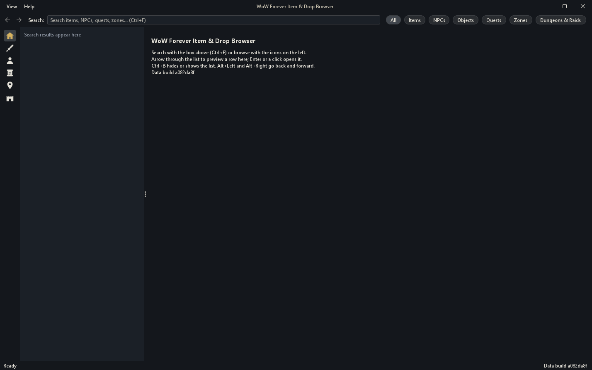
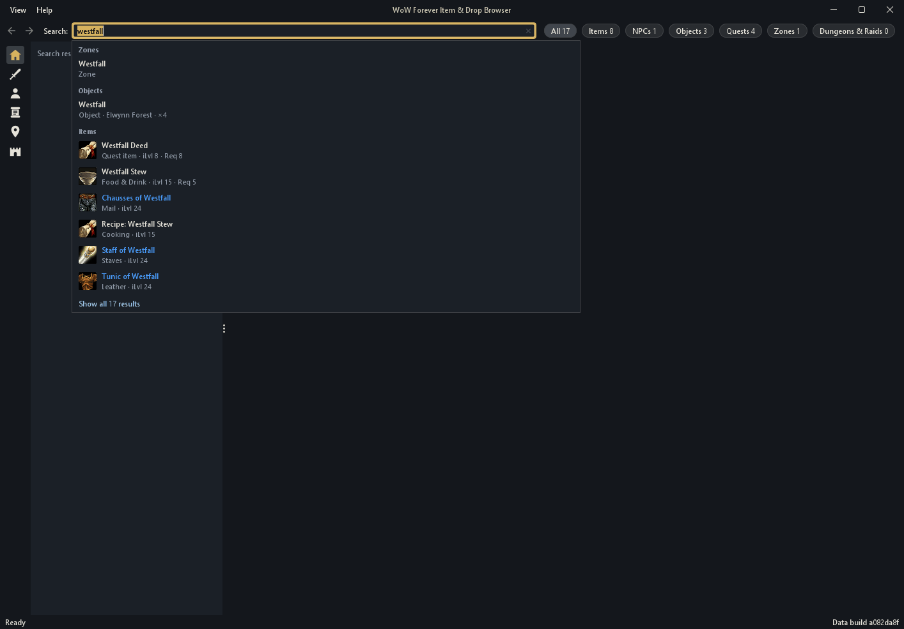
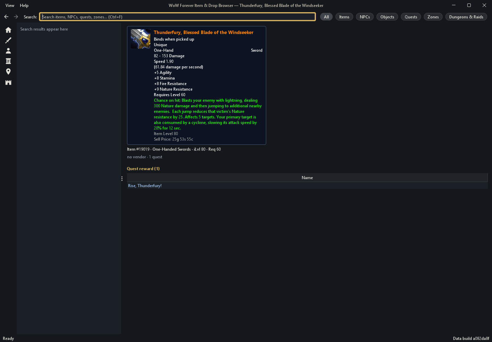
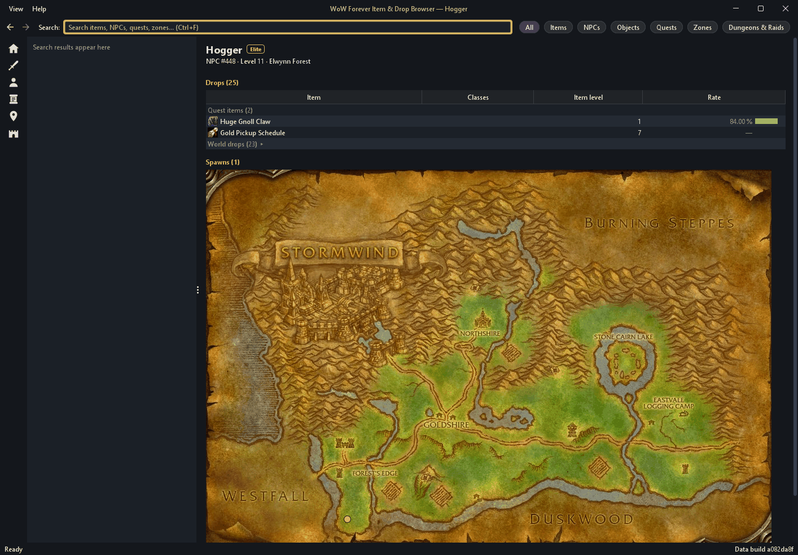
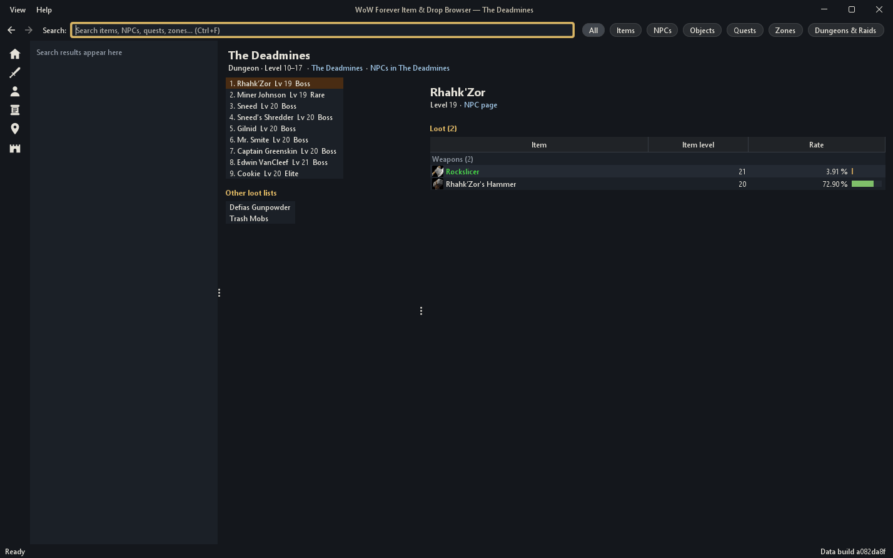
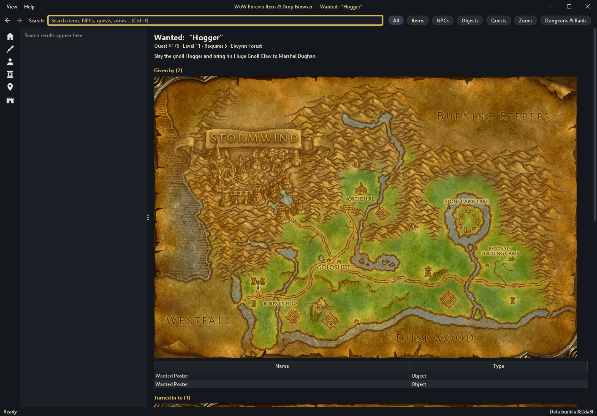
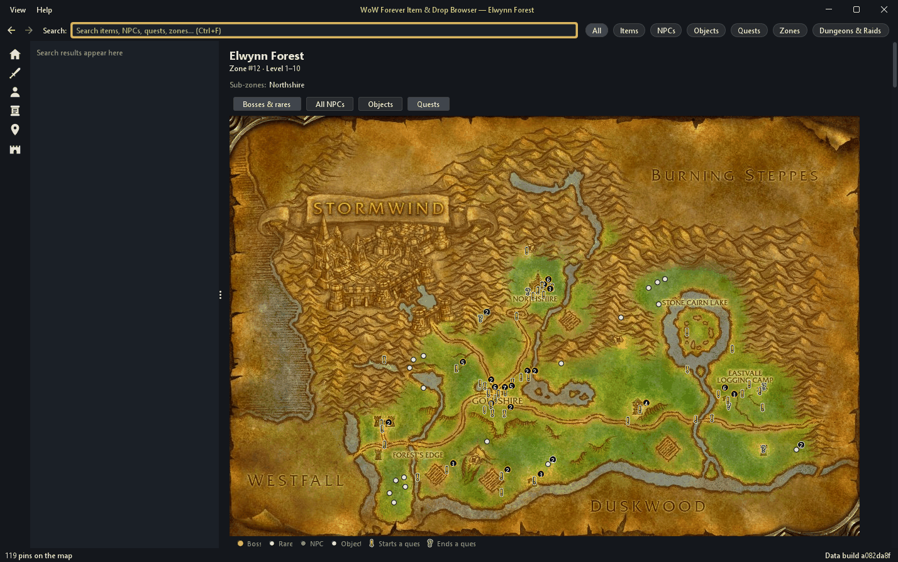
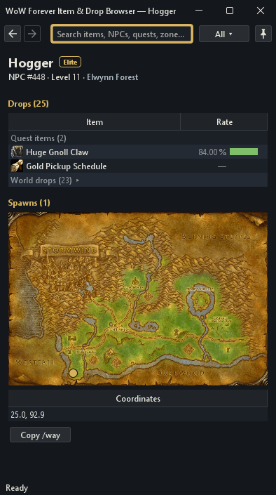

# WoW Forever Item & Drop Browser

## What it is

A desktop browser for World of Warcraft: Forever items and their sources. You search for an item, NPC, object, quest or zone, and cross-linked detail panels show where items drop, who sells them, which quests give them and where creatures spawn. Items show their in-game tooltip, quality colour and icon, and zones show their map. The data is built from QuestieDB's Forever flavour, AtlasLootClassic and the Blizzard client data of the Forever beta, and it ships inside the application as a SQLite database. Forever launches on 4 Nov 2026, and the upstream Forever data is still being completed by the community, so expect gaps and corrections in later builds.



## Requirements

Java 21 or newer. Nothing else is needed to run the application.

## Run

```
java -jar app/target/wow-forever-browser.jar
```

On first start the embedded database is extracted to a per-user data directory, and it is replaced when a newer build is shipped:

| OS | Data directory |
|---|---|
| Windows | `%LOCALAPPDATA%\WoWForeverBrowser` |
| macOS | `~/Library/Application Support/WoWForeverBrowser` |
| Linux and others | `$XDG_DATA_HOME/wowforever-browser`, or `~/.local/share/wowforever-browser` |

`java -jar app/target/wow-forever-browser.jar --self-test` opens the database without showing a window and prints a line such as `items=21543 npcs=13392 instances=37 build_id=...`. CI uses it to check the packaged jar.

## Using the app

The window has a rail of section icons on the left, the search box and its results list beside it, and the page on the right. Back and forward work as in a browser, with the toolbar arrows, Alt+Left and Alt+Right or the mouse's side buttons.

### Search

Type in the search box (Ctrl+F) to find items, NPCs, objects, quests, zones and dungeons as you type. A dropdown shows the top hits in their quality colour and icon. The kind chips on its top row (All, Items, NPCs and so on) narrow it and count the hits of each kind. From the box, Up reaches the chips, Left and Right move along them and Enter picks one. Enter opens the selected or the top hit, and the results list fills with that search. Shift+Enter or "Show all" lists every hit instead. In the results list, Up and Down preview a row on the page, and Enter or a click opens it. Opening a result collapses the list so the page gets the width, unless the window is at least 1600 px wide. Esc brings the list back, and Ctrl+B keeps it open. Clicking into the empty box, Ctrl+F or `/` shows your recent searches.

Pasting a whole item link, an `item:19019` text, a Wowhead URL or a bare id over the box opens that page. Pasting `[Name]` searches for the name.



### Rail and list pages

The rail opens Home and the list pages: Items, NPCs, Quests, Zones, and Dungeons & Raids. A list page has a filter bar over a sortable table. Items filter by class, subclass, quality and item level, NPCs by zone, rank and level, quests by zone and level. Dungeons and raids are grouped by level band. A click on a name opens it, and Back returns to the list with its filters.

### Item pages

An item with client data opens with its tooltip card as the game shows it: the icon, the name in its quality colour, stats, effects and set bonuses. Set pieces on the card open their own pages. Below the card come the item's sources: Dropped by, ranked by drop rate, then In instance loot, Contained in, Sold by, Quest reward and Related quests. Ctrl+1 to Ctrl+6 jump to the first six sections.

A rate bar shows each drop chance. A rate marked "≠" has sources that disagree, and its tooltip lists them. A rate marked "V" is a Vanilla rate from VMaNGOS. On dungeon and raid bosses its tooltip adds "Vanilla rate; Forever loot reworked", and a VMaNGOS rate that applies only while on the quest reads "on quest". An origin chip reads "AtlasLoot" on a row only AtlasLoot gives and "Questie + AtlasLoot" on one both give; QuestieDB-only rows have none.



### NPC, dungeon, object and quest pages

An NPC page shows the NPC's rank chip, its drops grouped by kind (Gear, Recipes, Quest items, Trade goods and so on) and its spawn points on the zone map. Recipes show the skill they need. Recipes, trade goods, food and other generic items that many NPCs drop are folded into a "World drops" group at the end when their rate is unknown or below 10 %; a shared drop at 10 % or more, such as a murloc's Murloc Eye, stays in its own group because it is what the NPC is farmed for. Click the World drops heading, or select it and press Enter, to open it. "Copy /way" copies the selected spawn point as a `/way Westfall 42.3 67.4` command for a waypoint addon.



A dungeon or raid page lists the numbered encounters, with AtlasLoot's extra lists under "Other loot lists", beside the loot of the selected one. The loot is grouped by Weapons, Armour, Jewellery and Recipes, and a muted Classes column names class-restricted items. A switch appears when the loot has more than one difficulty. "NPCs in" the instance's zone opens the NPC list of that zone.



An object page lists what the object contains and where it spawns. A quest page shows who gives the quest and who takes it back, on their zone maps, then its rewards and related items.



### Zone maps and pins

A zone page shows the zone's level band, its dungeons and sub-zones, and the zone map. By default the map pins the zone's bosses and rares. The toggles above it add every NPC, the objects and the quest givers. A quest giver shows Questie's yellow "!" where it starts a quest and a grey "?" where it only takes quests back. A legend under the map names each kind of pin.

Hover a pin to see who or what it is, and click it to open its page; a quest giver's pin opens its quest. Pins close together merge into one marker with a count, and a click on it opens a menu of what is there.



### Drop sources filter

The small control beside the Dropped by heading on item pages and the Drops heading on NPC pages hides the NPC drop rows of one source: "Hide AtlasLoot-only rows" or "Hide Questie-only rows". A note under the section says how many rows it hid. The dungeon and raid loot lists in Dropped by are never filtered. The control's tooltip explains the marks a rate can carry, such as "≠" when the sources disagree. The choice is remembered.

### Compact mode

F10 switches the window to a narrow layout for a second screen. The search box, the back and forward buttons and a pin button that keeps the window above others stay at the top, and the page fills the rest. Tables keep the name, rate and origin columns, and a row's tooltip tells the others. The map toggles fold into a "Pins ▾" menu. A right-click on the top bar opens the menu bar's items. Ctrl+Shift+T keeps the window above others in either layout, and F10 again returns to the full window.



### Keyboard

Help › Keyboard shortcuts shows the same table in the app.

<!-- keymap:start -->
| Keys | Action |
|---|---|
| Ctrl+F, Ctrl+L, / outside text fields | Focus search |
| Esc | Close dropdown, then clear search, then focus list |
| Alt+Left/Right, mouse 4/5 | Back / forward |
| Up/Down, Enter | Preview, open |
| Ctrl+1…6 | Jump to source section |
| Ctrl+C / Ctrl+Shift+C on a row | Copy name / copy item:ID or /way |
| Ctrl+B | Toggle results list |
| F10, Ctrl+Shift+T | Compact mode, always on top |
| Ctrl+= / Ctrl+- / Ctrl+0 | Text size |
| Up from the search box, Left/Right, Enter | Pick a kind chip in the dropdown |
<!-- keymap:end -->

The window remembers its size, layout, theme (View › Slate theme or Parchment theme), text size and drop source filter between runs.

## Build

```
./mvnw -B verify
```

Use `.\mvnw.cmd -B verify` on Windows. The build produces `app/target/wow-forever-browser.jar` (a single runnable jar that contains the database) and `importer/target/importer.jar`.

## Rebuild the data

**First, the build watch.** It compares every upstream with what the shipped database was built from and changes
nothing:

```
tools/clientdata/.venv/Scripts/python.exe -I tools/build_watch.py
```

It prints one line per upstream: the patch service's `wow_classic_beta` and `wowf` versions, wago.tools' newest build,
the Raidbots hotfix cache (its header build, read with a 44-byte range request, and its Last-Modified), the QuestieDB
master commit, and AtlasLoot. Each reads `fresh`, `STALE`, `unknown` (the upstream could not be read; never taken
for fresh) or, for AtlasLoot, `manual check` with the pinned version, since CurseForge refuses automated requests.
It exits 1 when anything is stale, 2 when nothing is stale but something is unknown, and 0 when everything is fresh.
`--lock` and `--sources` point it at another `build.lock` or `sources.properties`.

The shipped database `app/src/main/resources/data/wowforever.sqlite` is generated by the `importer` module from two pinned upstream sources: QuestieDB at commit `49e7dbc` and AtlasLootClassic at commit `8e99341`. The pins live in `importer/src/main/resources/dev/wowforever/importer/sources.properties`. Community drop rates come from a third pinned source, the VMaNGOS world database (see "Community drop rates" below).

Quests come from QuestieDB as well. Schema version 3 adds their objectives (`quest_objective`, with the exploration points in `quest_objective_point`), the items a quest provides or requires (`quest_source_item`) and the chain relations between quests (`quest_relation`: prerequisites, follow-ups, exclusive and grouped quests, breadcrumbs).

Dungeons and raids come from AtlasLootClassic, with their bosses and loot. The four WoW: Forever dungeons AtlasLoot does not know come from the client's own tables (schema version 4): City of Dalaran, Excavation Site: Wetlands, Ruins of Lordaeron and The Hall of Thanes. Each has `instance.source = 'client'`, its tuned minimum level and the bosses the client names, in order; the client has no loot tables, so they have no boss loot. The tools README, "Dungeon tables", gives the rule. Without the client's `LFGDungeons`, `ContentTuning` and `DungeonEncounter` tables the import leaves them out and reports `clientdata.instances.skipped = 1`.

The same schema holds three more data sets, which the browser does not show yet:

- **Patrol routes.** `npc_waypoint` holds the walking routes QuestieDB records for patrolling NPCs, per zone and route, in walking order.
- **Crafting.** `craft`, `craft_reagent` and `craft_recipe_item` come from the client's spell tables: what each crafting spell creates, from which reagents, at which skill, and which recipe items teach it. They need the client tables `SpellReagents` and `SkillLineAbility`; without them the import skips crafting and reports `clientdata.crafts.skipped = 1`.
- **Community drop rates.** The VMaNGOS rates join the other rate sources in `drop_rate_source`. Questie's observed rates outrank them, and they outrank the AtlasLoot drop tables. A rate that applies only while on the quest (`quest_only = 1`) ranks last.

Item quality, stats, tooltips, icons, zone maps and the navigation rail's UI icons come from Blizzard client data, fetched and converted by `tools/clientdata` into a directory such as `~/.cache/wowforever-clientdata/out/current`. The rail icons need the fetch step's `--ui-icons` flag; without them the `ui_asset` table stays empty. The next section describes that step.

Build the importer, then run it from the repository root:

```
./mvnw -B -pl importer -am package -DskipTests
java -jar importer/target/importer.jar --out app/src/main/resources/data/wowforever.sqlite --fail-on-unsupported \
    --client-data-dir ~/.cache/wowforever-clientdata/out/current --server-db-dir ~/.cache/wowforever-serverdb/4641790
```

The same import runs inside Maven with `./mvnw -B -pl importer -am -Pimport-data verify`. It reads the client data from `~/.cache/wowforever-clientdata/out/current` unless you pass `-Dclientdata.dir=<dir>`, and `-Dclientdata.skip=true` imports without client data. `-Dclientdata.coverageMin=<pct>` sets the coverage threshold described below. The profile passes all importer arguments as one string, so `-Dexec.args=...` replaces the whole argument list, `--out` included.

- **Download cache.** Upstream files are downloaded once into `~/.cache/wowforever-importer` and reused afterwards. Use `--cache <dir>` to put the cache elsewhere, or `--questiedb-dir` and `--atlasloot-dir` to read local checkouts instead.
- **An AtlasLoot zip pin.** `sources.properties` can pin AtlasLoot as a CurseForge zip instead of a GitHub commit (`atlasloot.kind=zip`, with its name, version, download page, file name and SHA-256). CurseForge refuses automated downloads, so the importer never fetches it: download the zip by hand from the pinned page and place it, unopened, in `~/.cache/wowforever-importer/<atlasloot.zipDir>/`. The importer checks its SHA-256 and extracts only the pinned files. `atlasloot.rateSource` names its drop rates (the app labels `atlasloot-forever` "AtlasLoot Forever"). `atlasloot.baseline.*` pins the GitHub commit it replaced: its boss rows that the new pin dropped stay while Questie or VMaNGOS still list them, and the report counts `atlasloot.forever.removedVsHoizame` (with `.kept`, `.dropped`, `.unplaced`) and `atlasloot.forever.additions`. Swapping AtlasLoot editions changes only `sources.properties`.
- **Client data.** Exactly one of `--client-data-dir <dir>` and `--skip-client-data` is required. With `--skip-client-data` the client tables are created empty, no item is marked as having client data, and the database still opens in the browser without icons, quality colours or tooltips. A directory holding an Era fallback table (`csv/ItemSparse.era.csv`, `csv/ItemEffect.era.csv`) must have a `build.lock` that records the Era fallback (`fallback_product`, `fallback_build` and the table's own sha under `tables`); otherwise the file is left over from an earlier fetch and the import stops. Re-run `fetch.py --fallback-product wow_classic_era` and `convert.py` to fix it.
- **`--fail-on-unsupported`.** The importer exits with code 2 when a correction could not be applied to a field the browser shows, when a field the importer reads is missing from the upstream schema (`missingField.*` counters), or when a value of a field the browser shows could not be resolved (`unresolved.<kind>.<field>` counters). With client data it also exits with code 2 when fewer than 85 % of the named items have client data. Items without a name do not count on either side of that ratio. `--coverage-min <pct>` changes the threshold to any whole percentage from 0 to 100. The report shows the ratio as `clientdata.coverage.pct`, and its `clientdata.unmatched.ranges` note lists the unmatched item ids. Always pass the flag when refreshing the shipped database.
- **Community drop rates.** `--server-db-dir <dir>` adds drop rates from the VMaNGOS world database, which `python tools/serverdb/fetch.py` downloads into `~/.cache/wowforever-serverdb/4641790` (pinned by `tools/serverdb/serverdb.lock`). The Maven profile passes that directory, or `-Dserverdb.dir=<dir>`. Without the option, or when the directory has no `mangos.sqlite`, the import leaves the VMaNGOS rates out and reports `serverdb.skipped = 1`. Rate rules and counters are in `tools/serverdb/README.md`.
- **Outputs.** The importer writes `import-report.txt` and `build-id.txt` beside the database. Commit all three files together.

The committed build has these headline row counts:

| Table | Rows |
|---|---|
| item | 21,543 |
| item with client data | 20,492 |
| npc | 13,392 |
| item_npc_drop | 164,447 |
| item_tooltip_line | 161,815 |
| icon | 2,925 |
| zone_map | 57 |
| quest | 5,232 |
| quest_objective | 5,529 |
| quest_objective_point | 170 |
| quest_source_item | 1,391 |
| quest_relation | 7,666 |
| ui_asset | 12 |
| npc_waypoint | 23,015 |
| craft | 3,335 |
| craft_reagent | 8,707 |
| craft_recipe_item | 1,917 |
| drop_rate_source | 158,244 |

`import-report.txt` lists every counter. The quest counters are `quest.objective.kinds.*` (objectives by kind), `quest.sourceItems` and `quest.relation.missing`, which counts relation rows that name a quest absent from the database; those rows are kept. `npc.waypoints.npcs` and `npc.waypoints.points` count the patrol routes, `clientdata.crafts.*` the crafting rows, and `serverdb.*` the VMaNGOS loot rows read and rated (`tools/serverdb/README.md` explains them). The report's `clientdata.disputed` note names items whose computed values another source disputes; they are kept as computed. Thunderfury (19019) is the only one: the client tables give 82 - 153 damage, Wowhead's Forever tooltip 44 - 115.

Known gaps in the upstream data, as of this build:

- **Unknown-NPC references.** 325 `item_npc_drop` rows name an NPC id that is not in the NPC table.
- **Nameless stubs.** 242 items and 1 game object have no name. The items exist only because a QuestieDB correction gives them a quest-start link, and none of them is searchable.
- **Missing quest reference.** One `quest_relation` row names a quest that is not in the quest table: quest 4604's prerequisite 2955.

## Client data

The shipped database uses product `wow_classic_beta`, build 1.60.1.70450, with the Classic Era `ItemSparse` and `ItemEffect` of build 1.15.9.70003 as the fallback for items the beta lacks: their stats and their Use, Equip and Chance on hit effects come from Era, the effect texts from the beta's spell tables. `tools/clientdata/build.lock` records the build and the SHA-256 of every table.

**Prerequisites.** Python 3 with the tool's own virtual environment (`tools/clientdata/README.md`, "Setup"), and network access to wago.tools or a local wow.tools.local (the fetch tool's default base URL, `http://localhost:5000`). Set `WOWFOREVER_CONTACT` to a contact URL before fetching from a public server; the User-Agent to wago.tools carries it, and no other host gets it (see the tools README, "Politeness"). The tool reads the exports only; it never touches a World of Warcraft installation.

**The three commands.** Fetch, convert, then import (the import command is in the previous section). With `B=1.60.1.70450` and `C=~/.cache/wowforever-clientdata`:

```
python tools/clientdata/fetch.py --product wow_classic_beta --build $B --base-url https://wago.tools --cache $C \
    --fallback-product wow_classic_era --fallback-build 1.15.9.70003 --maps --ui-icons --hotfix-cache \
    --fdids "$(python tools/clientdata/needed_icons.py --db app/src/main/resources/data/wowforever.sqlite --cache $C --build $B)"
python tools/clientdata/convert.py --cache $C --build $B --out $C/out/current
java -jar importer/target/importer.jar --out app/src/main/resources/data/wowforever.sqlite --fail-on-unsupported \
    --client-data-dir $C/out/current --server-db-dir ~/.cache/wowforever-serverdb/4641790
```

`needed_icons.py` lists the icons of the items already in the database, so on a fresh item set run the import once with `--skip-client-data` first. Its `Item.csv` must be in the cache, so the first fetch without `--fdids` comes before it. Every fetch run merges into the build's `build.lock`, so the tables, maps and icons may be fetched in separate runs. After the import, copy `$C/out/current/build.lock` to `tools/clientdata/build.lock` and commit it with the database.

**Hidden items revealed by hotfixes.** Blizzard hides thousands of Forever items from the client tables until one drops on a realm; their rows then reach every client as hotfixes. `fetch.py --hotfix-cache` snapshots the beta client's hotfix cache as mirrored by Raidbots into `$C/hotfix/<sha256>.bin` and records its header build, SHA-256, Last-Modified and fetch time in `build.lock` under `hotfix`, with the WoWDBDefs definitions the rows are decoded with. `convert.py` turns the valid rows into `csv/ItemSparse.hotfix.csv`, `csv/Item.hotfix.csv` and `csv/ItemEffect.hotfix.csv` plus `hotfix.json`. The importer prefers a hotfix row to Forever's and Forever's to Era's (`item.client_source` `hotfix`, `forever` or `era`), and the tooltip footer says where the stats come from. The cache's header build must equal the `build.lock` build: otherwise convert and import stop and name the build watch. The tools README, "Hotfix overlay", has the details and counters.

**UI icons.** The navigation rail's six icons are client textures too (spec section 5; client art is used for icons only). `--ui-icons` resolves each icon's texture path to a FileDataID with the client's own `ManifestInterfaceData` table, falls back to a second choice when the first is missing, fetches the files and records the choices in `build.lock` under `ui_icons`. `convert.py` writes each one twice into `ui_icons/`, at native size and at 24 px, and the importer embeds both in the `ui_asset` table under names like `rail.quests` and `rail.quests@24` (report counter `clientdata.uiAssets`). Build 1.60.1.70450 uses the first choice of all six. The tools README, "UI icons", lists them.

**Sizes.**

| What | Size |
|---|---|
| Fetch cache (53 tables, 6,313 BLP files) | 219 MB |
| Converted output (`out/current`) | 67 MB |
| Shipped database | 81 MB, of which icons 13 MB, zone maps 11 MB, the VMaNGOS rate rows 9 MB, patrol routes 1.4 MB, the quest tables about 1 MB and crafting 0.7 MB |

**Switching to the live build.** When Forever's live product `wowf` publishes a build, fetch it with `--product wowf` (and its build), convert it into a new `out/` directory, and import with `--client-data-dir` pointing there. Check the report's `clientdata.coverage.pct`, `clientdata.unverified.*` and `clientdata.unformatted` counters against this build's, run `./mvnw -B verify` (the shipped-data tests and the known-items oracle), and commit the database with the new `tools/clientdata/build.lock`. The Era fallback stays until the live `ItemSparse` covers those items.

## Tests

```
./mvnw -B verify
```

To skip the checks against the shipped database, which extract the 81 MB resource and take a moment:

```
./mvnw -B verify -DexcludedGroups=shipped-data
```

- **lua-table.** The Lua lexer, parser and evaluator, and the table values they produce.
- **importer.** Source loading, QuestieDB and AtlasLoot parsing, correction layers, drop and zone derivation, and the SQLite schema, mostly against fixtures.
- **app.** The repositories and database installer against a fixture database, the Swing panels and navigation (headless), a check that this README's keyboard table matches the app's key map, and the `shipped-data` sanity tests against the real committed database: row counts, orphan limits, known drops, client data coverage, icons, zone maps, quest objectives and relations, the rail's UI icons, patrol routes, crafting, the VMaNGOS drop rates, the importer's known-items oracle (`known-items.csv`) on the stored stats, damage, armour and tooltip lines, and one page of every kind built, laid out and painted from it.
- **tools.** `tools/clientdata` and `tools/serverdb` have their own pytest suites; their READMEs give the commands.

## Packaging

Native installers (MSI, DMG, DEB) can be built with `jpackage`; see [packaging/README.md](packaging/README.md).

## Data sources & licensing

- [QuestieDB](https://github.com/Questie/QuestieDB), commit `49e7dbca1f18eb3b8e57ee5d9562ac3e5c9adcc4`. It publishes no license file, so the data is used with attribution.
- [AtlasLootClassic](https://github.com/Hoizame/AtlasLootClassic), commit `8e99341e4e779328460bf7684c0d5b22ce50ddf1`, licensed under GPL-2.0.
- [VMaNGOS](https://github.com/vmangos/core) world database, release asset `db-sqlite-4641790.zip` (commit `464179081673cfd240f7ffe7f0daf96bca0b5a70`), licensed under GPL-2.0. Only derived drop percentages are stored.
- Blizzard client data of `wow_classic_beta` 1.60.1.70450, exported through [wago.tools](https://wago.tools). Icons, UI textures and map art are © Blizzard Entertainment and are included for reference; no affiliation.

This project is licensed under GPL-2.0-or-later, see `LICENSE`. Full credits are in [NOTICE.md](NOTICE.md).

## Known limitations

- Item values come from the Forever beta client, not the live game. About 4,800 items use Classic Era rows for their stats and effects instead, and their tooltip says so.
- 809 named items have no client data. 925 items with client data have no icon, and three more have an icon the converter cannot decode. All of them show a question mark.
- 114 weapons show no damage (`clientdata.unverified.damage`): 98 caster weapons, whose damage the client data does not explain, 15 weapons without a speed and one Frying Pan without a damage table.
- 171 spell descriptions keep placeholders the client data cannot fill, such as `$z` (your home inn). The tooltip shows each one as `?`.
- PvP and faction vendors are not imported. Crafting recipes and NPC patrol routes are in the database, but the browser does not show them yet.
- English only.
- Per-character (dynamic) corrections are not applied.
- Drop percentages exist for about 146,900 of the 164,447 drop rows. About 137,400 of them come from VMaNGOS, a vanilla server emulator's loot tables, so they are estimates for Forever's reworked loot.
- 325 drop rows reference NPCs that are missing upstream.
- 242 stub items have no name.
- Some Forever-only zone names are unconfirmed.

## Project layout

- `lua-table/` parses the Lua table syntax used by the upstream data files.
- `importer/` downloads the pinned sources, applies the layered corrections and writes the SQLite database and import report.
- `app/` is the Swing application: repositories over the database, the search, tree, results and detail panels, and the packaged jar.

## Contributing

Issues and pull requests are welcome. Run `./mvnw -B verify` before opening one, and refresh the database with the importer rather than editing it by hand.

## License

GPL-2.0-or-later, see `LICENSE`. Data credits are in `NOTICE.md`.
