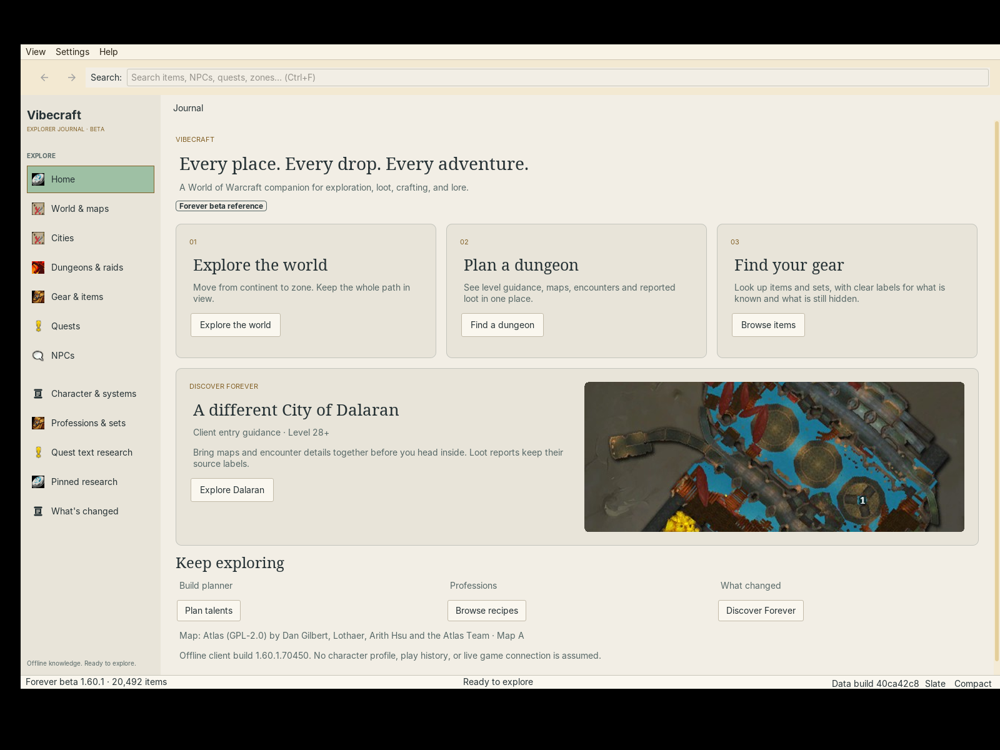

# Vibecraft

**Every place. Every drop. Every adventure.**

A World of Warcraft companion for exploration, loot, crafting, and lore.

*Built with artificial intelligence and natural stupidity. Works on my gryphon.*



**Find the drop. Follow the quest. Plan the next adventure.** Vibecraft connects items, NPCs, quests, recipes and maps in a desktop Explorer Journal. Follow an item to its sources, a boss to its loot, or a city district to its services—without losing your place.

[Preview status](#try-the-preview) · [Features](#inside-the-journal) · [Build from source](#build-from-source) · [Roadmap](docs/ROADMAP.md)

## Inside the Journal

| Your next question | Where Vibecraft takes you |
| --- | --- |
| **Where does this drop?** | Item tooltips, boss loot, vendors, quest rewards and source-qualified drop rates, with equipment filters. |
| **What is on this map?** | World-to-zone breadcrumbs, clickable NPC/object/quest pins, dungeon floors and recorded locations. |
| **What is in this city?** | City guides, districts, services and native city music, with independent music and interface-sound controls. |
| **Where does this quest lead?** | Givers, turn-ins, objectives, chains, rewards and connections to related items and places. |
| **How do I make this?** | Recipe reagents, crafting research and teaching-item acquisition trails. |
| **Can I trust this value?** | Source identity, field evidence and conflicting assertions, with explicit comparison data. |

Search across the catalog, paste an item link or Wowhead URL, and follow cross-linked pages. Back restores your browsing context. Pin useful references, increase text size, or switch to compact mode for a second screen. Database reads and image loading run on background workers.

NPC pages support **static portraits**; coverage is partial and missing images are identified. Interactive 3D models are outside the shipped scope.

### Forever means Forever

**WoW Forever is the only currently supported edition.** Forever facts come from Forever evidence; unknown beta values stay unknown. Classic Era comparisons are explicitly labeled rather than silently filling gaps. Classic, Retail and Anniversary/TBC support are planned, not available catalogs.

## Try the preview

**Local preview candidates exist; no public GitHub release is available yet.** There is no download link to chase until the first release is published.

Portable packages include Java and a compact gameplay database. Extract the whole archive and open the launcher—no separate Java, database server, Python, Node or Blender installation. Browsing the included catalog works offline; optional native audio may need a first download into the local cache.

| Platform | Current candidate | Launch verification |
| --- | --- | --- |
| **Linux x64** | **155.84 MiB** compressed, with Java and data | Native startup and relocation verified |
| **Windows x64** | **146.94 MiB** ZIP, with Java, data and `Vibecraft.exe`; assembled on Linux | **Not yet launch-tested on Windows** |
| **macOS Apple Silicon / Intel** | Not built | Not tested |

Keep the extracted application folder together. Settings and caches use per-user storage; “portable” describes the application folder, not a promise that every user file stays on a USB drive. The Linux candidate occupies approximately **1.24 GB extracted**, including its roughly **1.05 GB database**. Download size and installed size are different measurements.

See [preview notes](docs/releases/PREVIEW-0.4.1-preview.1.md), [packaging instructions](packaging/README.md) and [release preparation](docs/releases/README.md) for evidence and remaining gates. These are development previews, with incomplete data/portrait coverage and outstanding genuine collector-capture acceptance.

## Coming next: Vibemining

**Vibemining is planned as an area inside the main app.** The goal: choose your sources, inspect available Blizzard builds, and generate a local database without a terminal or a separate importer application.

The design includes optional sources such as AtlasLoot, automatic discovery of compatible local WoW installations before asking you to browse, read-only client extraction, and explicitly selected direct Blizzard CDN acquisition. Beta/preload data would be usable only when the required files are actually available and readable. Source selection, progress, provenance and conflicts belong in the same workflow.

This complete setup is **not shipped yet**. Official build-discovery backend work is implemented; the full source picker, local-client extraction and end-to-end database generation remain development work. Today, a source-built app can select an existing compatible database. See the [Vibemining design](docs/design/vibemining-setup.md).

## Build from source

Use **JDK 21**. The Maven wrapper handles Maven; end-user portable packages bundle their own Java runtime.

```sh
./mvnw clean verify
```

On Windows, use `.\mvnw.cmd clean verify`. This builds the source and runs fixture/unit checks. Tests requiring the full gameplay dataset explicitly skip when it is absent; a green source build does not mean full-data acceptance ran.

Generated databases and bulk assets are **not committed to Git**. To verify against an existing development dataset, place its database and matching sidecars outside the checkout:

```sh
./mvnw -Plocal-data \
  -Dwowforever.localDataDir=/path/to/development-data \
  clean verify
```

For a source-only application JAR:

```sh
./mvnw -Psource-only clean package
java -jar app/target/wow-forever-browser.jar
```

The current JAR filename is retained internally. Without bundled data, startup offers selection of an existing compatible database; it does not yet generate one. Full dataset requirements, sidecars and regeneration steps are documented in [local-data builds](docs/development/local-data-builds.md).

### Contribute

Bug reports are especially useful with the app version, operating system, selected data build, affected item/NPC/quest ID and steps to reproduce. Keep raw game files, generated databases, personal paths and credentials out of issues and pull requests.

| Working on… | Start here |
| --- | --- |
| App behavior and priorities | [Roadmap](docs/ROADMAP.md) |
| Reproducible builds and dataset tests | [Local-data development](docs/development/local-data-builds.md) |
| Portable packages and platform checks | [Packaging](packaging/README.md) |
| Small release datasets with provenance retained | [Runtime database export](docs/publishing/release-database.md) |
| Source selection and client datamining | [Vibemining design](docs/design/vibemining-setup.md) |
| Data and artwork attribution | [Third-party notices](NOTICE.md) |

<details>
<summary><strong>Keyboard shortcuts</strong></summary>

<!-- keymap:start -->
| Keys | Action |
|---|---|
| Ctrl+F, Ctrl+L, / outside text fields | Focus search |
| Esc | Close dropdown, then clear the map filter, then clear search, then focus list |
| Alt+Left/Right, mouse 4/5 | Back / forward |
| Up/Down, Enter | Preview, open |
| Ctrl+1…6 | Jump to source section |
| G / T / O / M / C / R | Quest page: Given by, Turned in to, Objectives, Map, Chain, Rewards |
| 1…9 | Quest page: show objective n on the map |
| [ / ] | Quest page: previous / next quest in the chain |
| Z | Quest page: next zone on the map |
| Ctrl+C / Ctrl+Shift+C on a row | Copy name / copy item:ID or /way |
| Ctrl+B | Toggle results list |
| F10, Ctrl+Shift+T | Compact mode, always on top |
| Ctrl+= / Ctrl+- / Ctrl+0 | Text size |
| Up from the search box, Left/Right, Enter | Pick a kind chip in the dropdown |
<!-- keymap:end -->

</details>

## License and credits

Vibecraft's code is licensed under [GPL-2.0-or-later](LICENSE). Third-party libraries, source datasets, fonts and artwork retain their respective licenses and rights; the code license does not relicense them. See [NOTICE.md](NOTICE.md) for source-specific credits.

World of Warcraft and Blizzard Entertainment are trademarks of Blizzard Entertainment, Inc. Vibecraft is an independent community project and is not affiliated with or endorsed by Blizzard.
