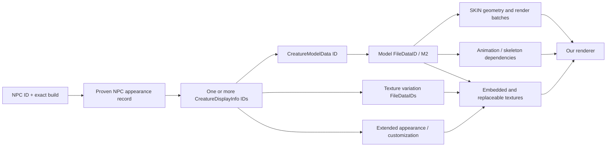

# NPC appearance data: local audit and proof of concept

Audit date: 2026-10-17. Read-only inspection of bundled build `40ca42c8e8c6442c0e2e633f76bf4f4638ebf23faf4029b568ee1ee038c207b7`. No candidate or bundled database was changed.

## Finding

Rendering NPCs from WoW assets is technically plausible. Our existing data does **not yet identify Seeking Remnant's appearance**. The first milestone must prove the NPC-to-display relationship before choosing a model or producing a render. A similar-looking ghost would be an illustration, not a datamined result.

The bundled database contains 13,392 NPCs. NPC **247003, Seeking Remnant**, has a name and ID; its level, rank, zone, faction, flags and other scalar fields are null, with no `npc_spawn` rows. Its Questie source is `src/corrections/Forever/generated/foreverBaseNpc.lua:4151` at commit `e9a67d1a2753a0e64c4c96bf7864788fac7b765f`; that correction contains only the name. The canonical `npc` schema has no display/model column. Questie item drop traces and quest objectives are not appearance evidence.

Across the 96 archived native table manifests (69 Forever, 27 Era), **zero** tables are named Creature, CreatureDisplayInfo, CreatureModelData, CreatureDisplayInfoExtra or FileData. There are no M2 or SKIN files in the repository acquisition caches. Existing BLP files are map/addon UI images, not a proven NPC model dependency set. `ui_asset` is not an NPC model archive.

Small read-only requests for the four missing tables were attempted at the existing source URL pattern, e.g. `https://wago.tools/db2/Creature/csv?build=1.60.1.70450`. Initial standard-library requests all returned HTTP 403. A second attempt using the same throttled pipeline client and user agent as the successful prior acquisition **succeeded with HTTP 200 for all four tables**. Exact URLs, byte counts, hashes, columns and row counts are retained in `.local/npc-render-research/acquisition-attempts.json`; raw CSVs remain outside the shipping database. The export contains Creature 184 rows, CreatureDisplayInfo 14,218 rows, CreatureModelData 1,193 rows and CreatureDisplayInfoExtra 8,994 rows. **Creature 247003 is absent.** This small Creature table cannot be assumed to contain all 13,392 canonical NPCs.

A verified control chain exists: **Mechanical Squirrel NPC 2671 → display 7937 → model 134 → model FileDataID 126061**, with replacement texture FileDataID **126062**, display scale approximately 1.3, alpha 255 and no extended appearance. Full native rows are saved as `.local/npc-render-research/mechanical-squirrel-chain.json`. The asset bytes have not been extracted.

A bounded filename search of `/home/aircan`, `/mnt` and `/media` to depth six found no `.build.info`, `WowClassic.exe`, `Wow.exe` or `data.000` files. This describes checked locations, not global absence of an installed client.

## Native relationship to resolve

The current [Creature definition](https://github.com/wowdev/WoWDBDefs/blob/master/definitions/Creature.dbd) declares `DisplayID` references and `DisplayProbability`. Its presence does not establish that this table contains every quest NPC; inspect the exact 70450 layout and row before relying on it. If NPC 247003 is absent, use an independently archived client creature query/cache record or verified game observation that actually supplies the relationship. Existing addon captures should not be assumed to expose display IDs through a supported Lua API.

[CreatureDisplayInfo](https://github.com/wowdev/WoWDBDefs/blob/master/definitions/CreatureDisplayInfo.dbd) links `ModelID` to CreatureModelData, carries texture variation file IDs, scale/alpha, and an extended-display reference. [CreatureModelData](https://github.com/wowdev/WoWDBDefs/blob/master/definitions/CreatureModelData.dbd) declares the model's `FileDataID`; build-specific layouts matter. [CreatureDisplayInfoExtra](https://github.com/wowdev/WoWDBDefs/blob/master/definitions/CreatureDisplayInfoExtra.dbd) includes race/sex, customization, baked textures and NPC equipment display fields. The definition catalogs include historical fields: select only the fields actually present in the chosen build.

[M2Loader in wow.export](https://github.com/Kruithne/wow.export/blob/main/src/js/3D/loaders/M2Loader.js) is a concrete implementation reference for model parsing and modern file-ID dependency chunks. Dependency resolution must inspect the model rather than infer filenames alone. The precise M2 revision, skin layout, animation/skeleton references and material behavior for a 70450 sample remain untested here. FileDataID resolution needs the matching client CASC/TACT root, encoding and content records; [TACTLib](https://github.com/overtools/TACTLib) is one implementation reference. A community listfile can provide readable filenames, but is not proof that bytes belong to our selected build.

## Evidence and conflict handling

Preserve every candidate display, its probability when supplied, exact provider, source row/key and snapshot. Do not collapse several forms into one arbitrary appearance. A spawn-specific outfit, transformation or event state may differ from a default template; label those variants explicitly. Never attach a Vanilla server database's similarly named creature to a new Forever NPC.

The appearance manifest should contain product, full build, locale, source snapshot hashes, NPC ID, display ID, model row ID, every input FileDataID and SHA-256, customization/equipment inputs, extraction tool version, renderer version, selected animation/time, camera and lighting settings. Cache keys must include those facts. Localized names identify the label; IDs and asset bytes establish identity. A missing or encrypted dependency remains unavailable and should be reported as such.

## Small proof of concept

1. **Done:** acquire and archive the four table exports for **1.60.1.70450** outside the shipping database. Next pin exact build-compatible layout definitions alongside the successful request manifest.
2. **Done:** query Creature row 247003; it is absent. Separately acquire trustworthy creature-query/cache evidence. Do not substitute Wowhead's displayed model ID as native provenance.
3. **Control chain proven:** Mechanical Squirrel resolves through display and model tables. Export only its M2 (126061), replacement texture (126062) and discovered dependencies from the matching client. Also select one simple beast and one equipped humanoid as control cases. Resolve Seeking Remnant only after obtaining its missing appearance mapping.
4. Render one transparent PNG and one studio-background PNG per proven appearance. Verify texture variations, geoset visibility, scale, alpha, orientation and a valid idle pose. Compare against a real game observation when available; a datamined render is not a screenshot of the NPC in its environment.
5. Produce a contact sheet and machine-readable dependency manifest. Fail visibly on missing dependencies, ambiguous mappings or unsupported materials. Do not turn a partially textured model into an apparently verified portrait.
6. Once the sample is correct, use offline generated thumbnails in Swing first. This isolates extraction/rendering work from the desktop app and avoids making every NPC page initialize a 3D engine. Interactive rotation/animation can follow behind the same manifest/cache boundary.

Suggested projection tables, once proven: `npc_appearance_fact` (many source-qualified displays per NPC), `model_asset_manifest` (build-qualified dependency graph), and `npc_render` (manifest hash plus render settings/output hash). Keep them separate from NPC names and loot selection so an appearance refresh cannot overwrite unrelated data.

## What this investigation did not establish

No Seeking Remnant display ID, model ID, FileDataID, model bytes, or rendered image has been verified. No success rate across the NPC catalog can yet be claimed. The deliverable here is a grounded acquisition boundary and testable pipeline, not a completed renderer.
